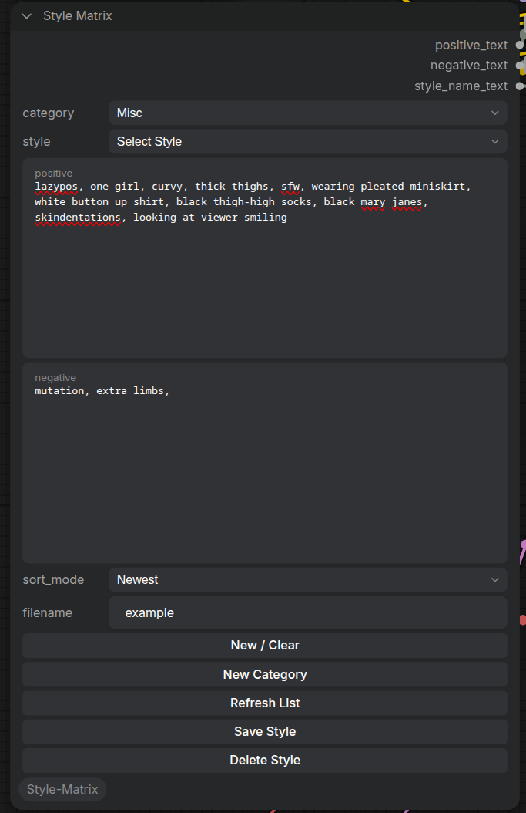

# ComfyUI Style Matrix

A clean, interactive prompt & style manager for [ComfyUI](https://github.com/comfyanonymous/ComfyUI).

Stop copy-pasting prompts out of random text files. **Style Matrix** isn't just a static preset loader—it's built from the ground up as a daily workspace for **writing new prompts from scratch, iterating on them live, saving them on the fly, and keeping a growing prompt library neatly organized** into folder-based categories without ever leaving ComfyUI.



## What It Does

- **Built for writing & iterating:** Use it directly in place of your CLIP text boxes—draft brand-new prompts, tweak existing ones live before generating, and hit **Save** the moment you nail a keeper.
- **Folder-based categories:** Subfolders inside your styles directory automatically show up as categories—plus an in-node **New Category** button.
- **Save & delete in-graph:** Save new styles or overwrite edits straight to `.json`, or delete old ones with a confirmation prompt.
- **Quick sorting:** Sort styles by `A-Z`, `Z-A`, `Newest`, or `Oldest`.
- **Works with any CLIP Text Encode node:** Outputs plain `STRING` (`positive_text`, `negative_text`, `style_name_text`).

## Installation

### Option 1: ComfyUI Manager (Recommended)
1. Open **ComfyUI Manager** → **Custom Nodes Manager**.
2. Search for **`Style Matrix`** (or `comfyui-style-matrix`) and click **Install**.
3. Restart ComfyUI.

Or via Comfy CLI:
```bash
comfy node registry-install comfyui-style-matrix
```

### Option 2: Manual (`git clone`)
```bash
cd ComfyUI/custom_nodes
git clone https://github.com/Sky-Wright/ComfyUI-Style-Matrix.git
```
Then restart ComfyUI.

## Quick Start

1. **Add the node:** Right-click on the canvas → `utils` → `styles` → **Style Matrix**.
2. **Wire it to your CLIP nodes:** On your positive and negative **CLIP Text Encode** nodes, right-click → **Convert Widget to Input** → `text`, then connect `positive_text` and `negative_text`.
3. **Create or load styles:** Type prompts straight into the node and click **Save** (no manual JSON editing needed), or drop existing `.json` style files into `ComfyUI/models/styles/`.

## Where Styles Are Stored

By default, Style Matrix looks for your styles folder in this order:
1. `search_paths` in `style_matrix_config.json` (if configured)
2. `styles:` in ComfyUI's `extra_model_paths.yaml`
3. `../models/styles` or `ComfyUI/models/styles`

Each style is saved as a simple `.json` file:
```json
{
  "name": "My_Style",
  "description": "Saved from ComfyUI Style Matrix",
  "prompt": "masterpiece, best quality...",
  "negative": "lowres, bad anatomy...",
  "extra": ""
}
```

## License

MIT
